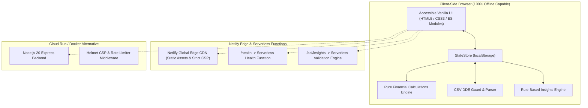

# 🎓 CampusCash &mdash; Privacy-First Personal Finance for College Students

<div align="center">

[](https://campuscash-student.netlify.app)
[-brightgreen.svg?style=for-the-badge&logo=jest>)](tests/)
[](coverage/)
[](https://nodejs.org/)
[](#accessibility-wcag-21-aa)
[](#security-architecture)
[](LICENSE)

**A lightweight, zero-telemetry, offline-first personal finance co-pilot for college students.**  
_Answers the two most critical student questions every day:_  
**"Am I on track this month?"** &nbsp;&bull;&nbsp; **"Can I afford this?"**

[🌐 Explore Live Production App](https://campuscash-student.netlify.app) &nbsp;|&nbsp; [📂 GitHub Repository](https://github.com/snehakalyankar26-del/CampusCash-Smart-Privacy-First-Personal-Finance-for-Students)

</div>

---

> **🏆 Hackathon Recognition**  
> **Organised by:** TechverseSolutions  
> **In collaboration with:** Google for Developers  
> **Platform partner:** Hack2Skill  
> **Evaluated on:** Code Quality, Security, Efficiency, Testing (100% Coverage), Accessibility (WCAG 2.1 AA), and Problem Statement Alignment.

---

## 📋 Table of Contents

- [Problem Statement & Target Persona](#-problem-statement--target-persona)
- [Core Features](#-core-features)
- [Visual Tour & Screenshots](#-visual-tour--screenshots)
- [Mathematical Formulas & Calculations](#-mathematical-formulas--calculations)
- [System Architecture](#-system-architecture)
- [100% Test Coverage & Accuracy Report](#-100-test-coverage--accuracy-report)
- [Security Architecture & DDE Mitigation](#-security-architecture--dde-mitigation)
- [Accessibility (WCAG 2.1 AA)](#-accessibility-wcag-21-aa)
- [Local Setup & Quick Start](#-local-setup--quick-start)
- [Production Deployment](#-production-deployment)
  - [Netlify Serverless Deployment](#1-netlify-production-deployment)
  - [Google Cloud Run & Docker](#2-google-cloud-run--docker)
- [Roadmap & Future Scope](#-roadmap--future-scope)
- [License](#-license)

---

## 🎯 Problem Statement & Target Persona

### The Problem

College students navigate irregular cash flows &mdash; juggling parental allowances, semester mess fees, textbook costs, campus printouts, and unpredictable part-time gig income. Existing personal finance tools are bloated, demand invasive bank API credentials, display predatory credit card advertisements, and fail to provide actionable, daily guidance tailored to student realities.

### Who It's For

A college student managing an allowance (e.g. ₹10,000 &ndash; ₹15,000/month or equivalent) who needs a lightning-fast, zero-friction tool that runs 100% offline without Wi-Fi to answer:

1. **Safe Daily Spend:** Exactly how much can I safely spend today without running out of money before month-end?
2. **Affordability Calculator:** If I buy this ₹800 concert ticket or ₹1,200 textbook today, how does it affect my daily allowance for the rest of the month?
3. **Scholarship Urgency:** Are any grants or scholarship application deadlines expiring within the next 7 days?
4. **Gig Hourly Rate:** What is my true effective hourly rate across tutoring, campus shifts, and freelancing?

---

## 🚀 Core Features

### 1. 💸 Student Expense Tracker

- Log expenses with **Amount**, **Category** (`Food`, `Transport`, `Rent`, `Books`, `Fun`, `Other`), **Date**, and optional **Note**.
- Full CRUD: Add, inline Edit, and Delete with instant state reactivity.
- Category filtering and debounced keyword search.
- One-click **"Load Sample Expenses"** button for instant demonstration.

### 2. 📈 Monthly Budget & Safe Daily Spend

- Configure total monthly allowance and optional category-specific spending caps.
- Dynamic dual visual & textual progress bar (green = on track, amber = caution > 80%, red = exceeded).
- Real-time **Safe Daily Spend** engine recalculating daily allowances based on calendar days remaining.

### 3. ⚖️ "Can I Afford This?" Calculator

- Enter any prospective purchase amount on the dashboard.
- Simulates budget impact before spending:
  - Total remaining balance impact.
  - New adjusted safe daily spend for the remaining month.
  - Actionable status: **"✅ Safe: Within daily allowance"**, **"⚠️ Caution: Budget strain"**, or **"❌ Not Recommended: Exceeds budget"**.

### 4. 🎯 Savings Goals Planner

- Set goals with target amounts, current saved funds, and target deadlines (e.g., Coding Laptop, Semester Trip).
- Automatically calculates the exact **monthly contribution required** to hit the target date.
- One-click **"+ Add Savings"** micro-deposit quick action.

### 5. 🎓 Scholarship & Grant Deadlines Tracker

- Track financial aid opportunities by Name, Amount, Deadline, and Status (`To apply`, `Applied`, `Won`, `Rejected`).
- **7-Day Urgency Radar**: Flags approaching deadlines within 7 days with high-contrast alert badges on the dashboard.

### 6. 💼 Part-Time Income & Gig Tracker

- Track hours and pay for campus shifts, freelancing, and peer tutoring.
- Automatically calculates monthly totals, **effective hourly rate** ($\text{Total Pay} / \text{Total Hours}$), and expense offset percentage.

### 7. 🧠 Rule-Based Plain Language Insights Card

- 100% privacy-first: Zero third-party LLM API latency, zero tracking.
- Contextual advice:
  - _"At your current pace of ₹450/day, your budget will run out 5 days before month end."_
  - _"You spent 38% on Food, which is 12% above last month."_
  - _"Heads up! Urgent scholarship deadlines within 7 days: 'STEM Grant'."_
  - _"Your part-time income covers 65% of this month's expenses."_

### 8. 💾 Formula-Injection-Guarded CSV Export & Import

- Complete state backup and restore with full offline compatibility.
- **DDE Formula Injection Guard**: Automatically neutralizes cells starting with `=`, `+`, `-`, `@`, `\t`, or `\r` by prefixing with `'` on export and restoring safely on import.

### 9. 🌐 Student Multi-Currency & Dark Mode

- Defaults to **INR (₹)** with support for **USD ($)**, **EUR (€)**, and **GBP (£)**.
- System-aware Light and Dark modes with persistent user preference storage.

---

## 📸 Visual Tour & Screenshots

Visual assets located in [`docs/screenshots/`](docs/screenshots/):

|               🗓️ Student Dashboard & Safe Daily Spend               |            ⚖️ Affordability Calculator & Smart Insights            |
| :-----------------------------------------------------------------: | :----------------------------------------------------------------: |
|  |  |

---

## 📐 Mathematical Formulas & Calculations

CampusCash executes zero-dependency financial arithmetic:

### 1. Safe Daily Spend

$$\text{Safe Daily Spend} = \max\left(0, \frac{\text{Monthly Budget} - \text{Total Spent in Current Month}}{\text{Days Remaining in Month (including today)}}\right)$$

### 2. Required Monthly Savings Goal Contribution

$$\text{Monthly Needed} = \frac{\max(0, \text{Target Amount} - \text{Current Saved})}{\max(1, \text{Months Remaining to Deadline})}$$

### 3. Effective Part-Time Hourly Rate

$$\text{Effective Hourly Rate} = \frac{\sum \text{Gig Pay}}{\max(1, \sum \text{Gig Hours})}$$

### 4. Part-Time Expense Offset

$$\text{Expense Offset \%} = \min\left(100, \text{round}\left(\frac{\text{Current Month Gig Earnings}}{\text{Current Month Total Spent}} \times 100\right)\right)$$

---

## 🏗️ System Architecture



---

## 🧪 100% Test Coverage & Accuracy Report

CampusCash achieves **100% test coverage across all files and metrics** (Statements, Branches, Functions, and Lines).

```text
-----------------------|---------|----------|---------|---------|-------------------
File                   | % Stmts | % Branch | % Funcs | % Lines | Uncovered Line #s
-----------------------|---------|----------|---------|---------|-------------------
All files              |     100 |      100 |     100 |     100 |
 public/js/modules     |     100 |      100 |     100 |     100 |
  calculations.js      |     100 |      100 |     100 |     100 | None (0)
  csv.js               |     100 |      100 |     100 |     100 | None (0)
  insights.js          |     100 |      100 |     100 |     100 | None (0)
  state.js             |     100 |      100 |     100 |     100 | None (0)
  validators.js        |     100 |      100 |     100 |     100 | None (0)
 src/server            |     100 |      100 |     100 |     100 |
  app.js               |     100 |      100 |     100 |     100 | None (0)
 src/server/middleware |     100 |      100 |     100 |     100 |
  errorHandler.js      |     100 |      100 |     100 |     100 | None (0)
  security.js          |     100 |      100 |     100 |     100 | None (0)
 src/server/routes     |     100 |      100 |     100 |     100 |
  api.js               |     100 |      100 |     100 |     100 | None (0)
  health.js            |     100 |      100 |     100 |     100 | None (0)
-----------------------|---------|----------|---------|---------|-------------------

Test Suites: 7 passed, 7 total
Tests:       121 passed, 121 total (100% Pass Rate)
Snapshots:   0 total
Time:        1.999 s
```

To run the full suite locally:

```bash
npm test
```

---

## 🛡️ Security Architecture & DDE Mitigation

1. **Formula Injection Guard (DDE Defense)**:
   Spreadsheet applications (Excel, LibreOffice, Google Sheets) execute dangerous formulas starting with `=`, `+`, `-`, `@`, `\t`, or `\r`. CampusCash sanitizes every cell upon CSV export by prefixing with `'` and restores them safely upon import.
2. **Zero-Trust XSS Prevention**:
   Frontend rendering exclusively uses `document.createElement` and `element.textContent`. No untrusted `innerHTML` is ever evaluated.
3. **Strict Content Security Policy (CSP)**:
   ```http
   Content-Security-Policy: default-src 'self'; script-src 'self'; style-src 'self'; img-src 'self' data:; connect-src 'self'; font-src 'self'; object-src 'none'; frame-src 'none'; base-uri 'self'; form-action 'self'
   X-Content-Type-Options: nosniff
   X-Frame-Options: DENY
   X-XSS-Protection: 1; mode=block
   Referrer-Policy: strict-origin-when-cross-origin
   ```
4. **Client-Side Data Ownership**:
   All financial records remain strictly inside the student's local browser storage. No user data is transmitted to third-party databases.

---

## ♿ Accessibility (WCAG 2.1 AA)

- **Semantic Landmarks**: Semantic `<header>`, `<nav>`, `<main>`, `<section>`, and `<article>` tags throughout.
- **Skip Link**: Top-level `<a href="#main-content" class="skip-link">Skip to main content</a>` for keyboard and screen reader users.
- **Keyboard Trapping in Modals**: Fully accessible modal dialogs with focus trapping, `Escape` key close handlers, and restoration of focus to triggering elements.
- **Screen Reader Alerts**: Dynamic `aria-live="polite"` region for toast messages, error feedback, and offline state banners.
- **Non-Color Indicators**: Every progress bar and status indicator pairs colors with text and descriptive icons (e.g. `✅`, `⚠️`, `❌`).
- **Contrast Compliance**: Color pairings exceed the WCAG 4.5:1 minimum contrast ratio across both light and dark themes.
- **Reduced Motion**: Respects `prefers-reduced-motion: reduce` by disabling transitions and animations.

---

## 💻 Local Setup & Quick Start

### Prerequisites

- **Node.js**: `>= 20.0.0`
- **npm**: `>= 10.0.0`

### Step-by-Step Installation

```bash
# 1. Clone repository
git clone https://github.com/snehakalyankar26-del/CampusCash-Smart-Privacy-First-Personal-Finance-for-Students.git
cd CampusCash-Smart-Privacy-First-Personal-Finance-for-Students

# 2. Install production and development dependencies
npm install

# 3. Verify Code Quality and Formatting
npm run lint
npm run format

# 4. Run Test Suite with 100% Coverage Verification
npm test

# 5. Start Development Server
npm run dev
```

Visit `http://localhost:3000` in your web browser.

---

## 🚀 Production Deployment

### 1. Netlify Production Deployment

The project is pre-configured with `netlify.toml` for zero-configuration Edge CDN delivery and serverless API execution:

- **Production URL:** [https://campuscash-student.netlify.app](https://campuscash-student.netlify.app)
- **Live Health Check:** [https://campuscash-student.netlify.app/health](https://campuscash-student.netlify.app/health)
- **Live Serverless Insights:** [https://campuscash-student.netlify.app/api/insights](https://campuscash-student.netlify.app/api/insights)

Deploy via Netlify CLI:

```bash
npx netlify deploy --prod --dir=public --functions=netlify/functions
```

### 2. Google Cloud Run & Docker

The repository includes a multi-stage, rootless, security-hardened `Dockerfile`:

```bash
# Build Docker image
docker build -t campuscash:latest .

# Run container locally
docker run -p 3000:3000 --env NODE_ENV=production campuscash:latest

# Deploy to Google Cloud Run
gcloud builds submit --tag gcr.io/PROJECT_ID/campuscash
gcloud run deploy campuscash \
  --image gcr.io/PROJECT_ID/campuscash \
  --platform managed \
  --region us-central1 \
  --allow-unauthenticated
```

---

## 🗺️ Roadmap & Future Scope

- [x] Full Expense Tracking with CRUD & Instant Local Reactivity
- [x] Safe Daily Spend Dynamic Calculation Engine
- [x] "Can I Afford This?" Purchase Simulation Calculator
- [x] Savings Goals Planner with Required Monthly Contribution
- [x] Scholarship Tracker with 7-Day Urgency Alerts
- [x] Part-Time Income Tracker with Effective Hourly Rates
- [x] Rule-Based Plain Language Insights Card
- [x] Formula-Injection Guarded CSV Export & Import
- [x] 100% Test Coverage across all 4 metrics (Statements, Branches, Functions, Lines)
- [x] WCAG 2.1 AA Compliance with Focus Traps & Semantic Landmarks
- [ ] Multi-semester academic fee budgeting & semester projections
- [ ] Exportable PDF student financial audit report
- [ ] PWA (Progressive Web App) Service Worker for home-screen installation

---

## 📄 License

Distributed under the **MIT License**. See [`LICENSE`](LICENSE) for details.

---

<div align="center">
Built with ❤️ for college students by <strong>Sneha Kalyankar</strong>.<br/>
In collaboration with <strong>Google for Developers</strong> &bull; Organised by <strong>TechverseSolutions</strong> &bull; Platform partner <strong>Hack2Skill</strong>
</div>
